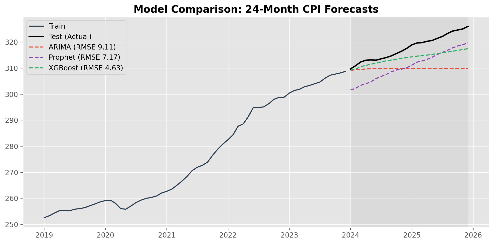
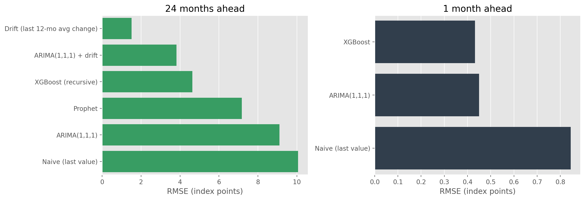

# CPI Forecasting on AWS SageMaker

Inflation forecasts feed into rate decisions, budgets and investment planning. This project compares statistical and machine-learning approaches for forecasting the U.S. Consumer Price Index (CPI), tests them against simple baselines, and deploys an XGBoost model to an AWS SageMaker endpoint.

## Key results

Training: Jan 1990 – Dec 2023. Holdout: Jan 2024 – Dec 2025 (24 months). Errors are in CPI index points. October 2025 is missing from FRED and is excluded from scoring.

**24 months ahead** (each model forecasts the full holdout from Dec 2023; 23 months scored)

| Model | MAE | RMSE |
|---|---|---|
| Drift (last 12-month average change) | 1.34 | 1.51 |
| ARIMA(1,1,1) + drift | 3.42 | 3.82 |
| XGBoost (recursive) | 3.91 | 4.63 |
| Prophet | 7.11 | 7.17 |
| ARIMA(1,1,1) | 7.88 | 9.11 |
| Naive (last value) | 8.91 | 10.06 |

**1 month ahead** (each forecast starts from the actual previous month; 22 months scored)

| Model | MAE | RMSE |
|---|---|---|
| XGBoost | 0.37 | 0.43 |
| ARIMA(1,1,1) | 0.40 | 0.45 |
| Naive (last value) | 0.76 | 0.85 |

- Over 24 months, a simple drift baseline beat every model, including XGBoost. XGBoost had about 45% lower MAE than Prophet but roughly three times the error of drift.
- One month ahead, XGBoost and ARIMA performed similarly, and both had about half the error of the naive baseline. The gap between XGBoost and ARIMA is small and comes from a single holdout window.

## Approach

- **Data:** FRED series CPIAUCSL (seasonally adjusted, monthly), Jan 1990 – Dec 2025. The end date is fixed so results are reproducible.
- **Baselines first:** naive, drift, ARIMA(1,1,1), ARIMA with drift, and Prophet.
- **XGBoost:** predicts the month-over-month change in CPI from the previous 12 monthly changes, then adds the predicted change back to the last level.
- **Same-setup comparison:** the 24-month table forecasts the whole holdout from one starting point for every model (XGBoost feeds its own predictions back in). The 1-month table starts each forecast from the actual previous month. An earlier version of this project scored XGBoost one step ahead against ARIMA and Prophet 24 steps ahead, which overstated XGBoost's advantage. This version corrects that.
- **Missing data:** FRED has no CPI value for October 2025. It is left missing, not filled, and excluded from scoring.

## Deployment

The XGBoost model is packaged with a custom inference handler and deployed to a SageMaker real-time endpoint (XGBoost framework container 3.0-5, `ml.m5.large`, SageMaker Python SDK v2). The endpoint accepts JSON with the last observed CPI level and the 12 most recent monthly changes, and returns the predicted next-month change and level. A live prediction was tested on the deployed endpoint (see `deployment/`), and the endpoint was then deleted to avoid ongoing cost.

## Limitations

- One holdout window of 24 months; no rolling or cross-validated evaluation.
- Hyperparameters were set by hand, not tuned.
- The model predicts changes in index points, not percent changes.
- Only past CPI is used as input; no other economic variables yet.
- FRED returns revised values, not what was known in real time.

## Stack

Python · pandas · XGBoost · statsmodels (ARIMA) · Prophet · AWS SageMaker · FRED

## Repository

- `Econ_Forecasting_v2.ipynb`: evaluation and model packaging
- `deployment/`: `inference.py`, `deploy_endpoint.py`, `deploy_cpi.ipynb`, deployment test logs
- `images/`: figures used above
